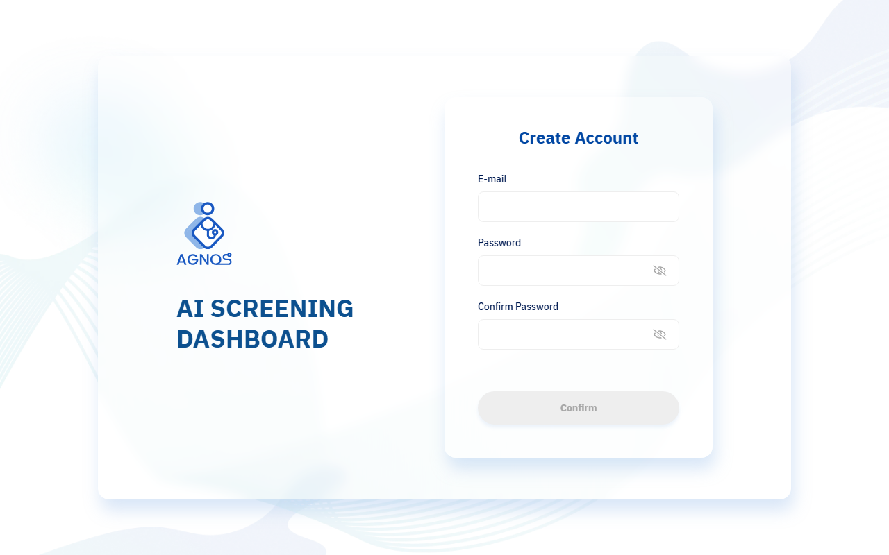
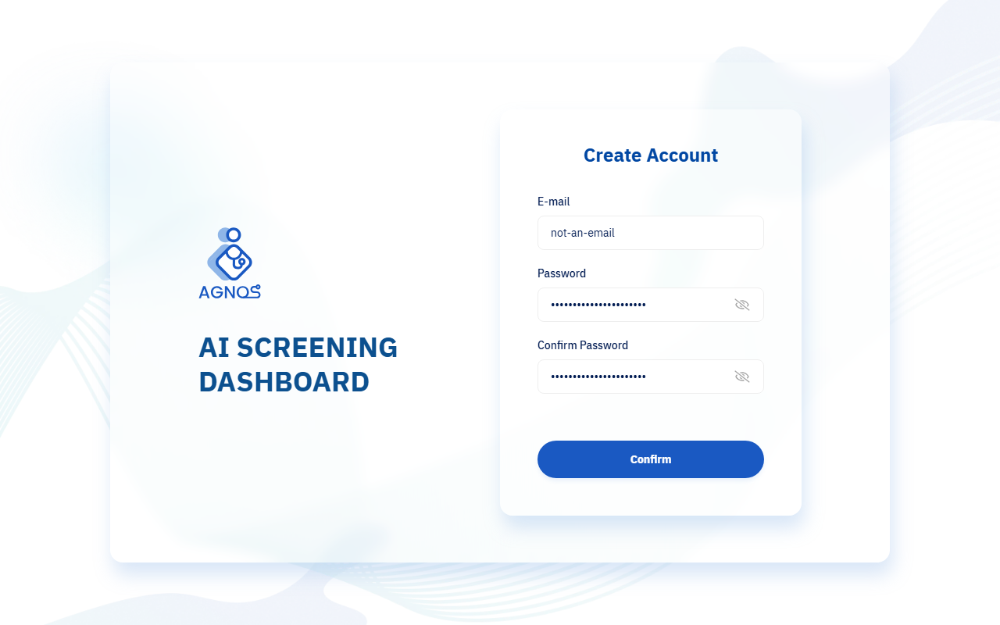
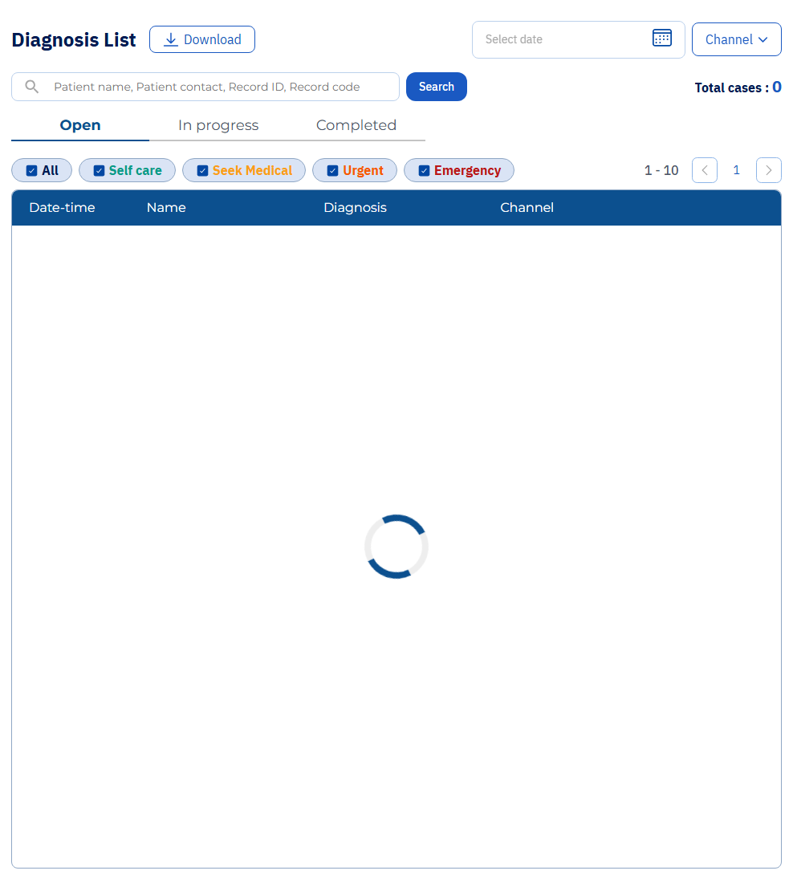

# Agnos AI Dashboard manual test report

**Date:** 2026-10-07
**Environment:** Agnos development environment
**Browser:** Chromium
**Test data:** Synthetic form values only. Password fields in screenshots contain a test-only value and remain masked.

## Summary

| Test ID | Result | Summary |
|---|---|---|
| SIGNUP-001 | Pass | Registration fields are visible and Confirm is disabled on initial load. |
| SIGNUP-002 | Fail | Confirm becomes enabled with a malformed email when both password fields match. The form was not submitted. |
| DATA-002 | Fail | Synthetic symptom flow reached the result screen, but the app returned HTTP 500 and the diagnosis did not appear in the staff dashboard. |

Other planned manual cases remain **Not Run**. Their current state and preconditions are listed in `TEST_PLAN.md` and `TEST_EXECUTION_REPORT.csv`.

## SIGNUP-001 — Registration form required fields

**Steps**

1. Open the dashboard signup URL.
2. Verify the E-mail, Password, and Confirm Password fields.
3. Verify Confirm is disabled before entering values.

**Expected:** All required fields are shown and Confirm is disabled.
**Actual:** All three fields were visible and Confirm was disabled.
**Result:** Pass.

## SIGNUP-002 — Reject malformed registration email

**Steps**

1. Enter `not-an-email` in E-mail.
2. Enter the same non-empty test-only password in Password and Confirm Password.
3. Observe Confirm; do not submit the form.

**Expected:** Confirm remains disabled or the invalid email is explicitly rejected.
**Actual:** Confirm became enabled. The form was not submitted, so no account was created.
**Result:** Fail — defect reproduced.

## DATA-002 — Generate synthetic AI diagnosis for dashboard testing

**Steps**

1. Open the development patient app as a guest.
2. Use a synthetic profile and accept the health-data consent for this test.
3. Complete the symptom questionnaire and finish the AI analysis.
4. Check the staff Dashboard Diagnosis List for the generated case.

**Expected:** The diagnosis completes successfully and appears in the staff dashboard.
**Actual:** The symptom flow reached the AI result page, but the app returned HTTP 500. The staff dashboard showed `Total cases: 0`. Its list spinner was still visible when the screenshot was captured, so the screenshot records the count at that moment rather than a settled list state. No diagnosis record was observed.
**Result:** Fail — environment/application issue observed. No additional diagnosis was created.

## Remaining manual cases

- SIGNUP-003 (successful registration): Not Run. Requires a unique disposable email and creates a persistent account.
- AUTH-001 through AUTH-003 and DASH-001: Automated checks passed, but no separate manual execution is claimed.
- PAT-001 and PAT-005: Blocked because no diagnosis record was saved.
- PAT-002 through PAT-004 and DATA-001: Manual validation against returned records remains blocked until synthetic diagnosis data is available.

Screenshots are stored locally in `manual-evidence/`. Do not add real patient details, credentials, or unmasked secrets to screenshots or reports.
